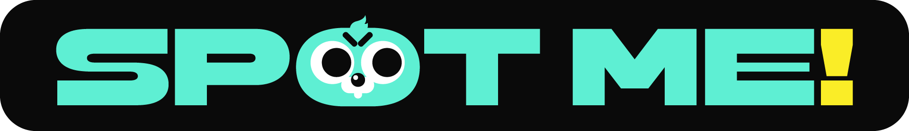

<p align="center">
  
</p>

<h1 align="center">SPOT ME · Website</h1>

<p align="center">
  혼자 막혔던 운동, 레미와 함께.<br />
  AI 운동 파트너와 운동을 통한 성장을 소개하는 인터랙티브 웹사이트
</p>

<p align="center">
  <a href="https://spotme-site.vercel.app/">사이트 보기</a> ·
  <a href="#시작하기">시작하기</a> ·
  <a href="docs/README.md">문서</a>
</p>

---

## 프로젝트 소개

실제 앱의 에셋과 화면을 바탕으로 SPOT ME의 기능을 스크롤과 짧은 상호작용으로 소개합니다. 모바일 앱 자체가 아니라 **홍보·체험용 웹사이트**입니다.

| 메뉴 | 경로 | 주요 내용 |
| --- | --- | --- |
| 홈 | `/` | 브랜드 오프닝, 운동의 고민과 레미의 도움을 소개하는 스토리 |
| 기능 | `/features/` | 운동 리포트·헬스장·전투 데모, 성장 카드와 레미 운동 시퀀스 |
| 레미 AI | `/remi-ai/` | 루틴 생성·운동 추천·기록 피드백·식단 추천의 준비된 응답 체험 |
| 시연 영상 | `/video/` | 웹용으로 압축한 MP4를 직접 재생하는 플레이어 |

> 레미 AI 응답과 운동 수치는 **샘플 데이터**입니다. 사이트에서 실제 AI 상담이나 사용자 운동 기록 저장을 수행하지 않습니다.

### 인터랙션

- 타이포그래피와 레미 인피니티 미러로 이어지는 홈 오프닝, 세션 단위 재생 이력 관리
- 스크롤에 따른 기능 소개·리포트 표시, 헬스장 성장과 티어 전환
- 루틴 확인 → 운동 중 조정 → 전투·완료로 이어지는 체험 시퀀스
- Canvas 기반 치즈 낙하·폭발 효과와 화면 밖 파티클 그리기 생략
- 탭 전환과 에셋 사전 로딩, 모션 감소 설정을 고려한 주요 애니메이션

## 기술 구성

| 기술 | 버전 | 용도 |
| --- | --- | --- |
| Next.js | 15.5.28 | App Router, 페이지 생성·라우팅 |
| React / React DOM | 19.2.8 | 화면과 상호작용 상태 관리 |
| Motion | 13.4.4 | UI 전환·스크롤 연동 애니메이션 |
| GSAP | 3.15.0 | 오프닝 타임라인 |
| Lenis | 1.3.26 | 부드러운 스크롤 |
| lottie-web | 5.13.0 | Lottie 재생용 의존성·컴포넌트 준비 |

스타일은 CSS로 관리하며 배포 대상은 Vercel입니다. 정확한 의존성은 [package.json](package.json)과 [package-lock.json](package-lock.json)을 기준으로 합니다.

## 시작하기

Node.js와 npm이 필요합니다. 로컬 검증은 Node.js 22 환경에서 진행했습니다.
**모든 명령은 저장소 루트에서 실행합니다.**

```bash
npm ci
npm run dev
```

개발 서버: [http://127.0.0.1:4189](http://127.0.0.1:4189)

프로덕션 빌드 확인:

```bash
npm run build
npm run start
```

빌드본 서버: [http://127.0.0.1:4192](http://127.0.0.1:4192)

개발 캐시는 `.next-dev/`, 프로덕션 빌드는 `.next/`에 생성됩니다. 제공된 화면·데모 실행에 Figma API 키는 필요하지 않습니다.

## 폴더 구조

```text
spotme-site/
├── app/                         # 페이지 경로와 공통 레이아웃
├── src/
│   ├── components/              # 공통 UI
│   ├── concept/                 # 기능 체험과 레퍼런스 구현
│   ├── generated/               # Figma 기반 화면 데이터·스타일·모션 코드
│   └── integration/             # 홈, 메뉴, 레미 AI, 영상, 페이지 전환
├── public/                      # 실제 사용하는 이미지·폰트·영상
├── scripts/                     # 에셋 가공과 검증 도구
│   └── archive/v3/              # 과거 정적 사이트 도구 — 현재 실행 대상 아님
├── design-reference/            # 동결된 Figma 자료와 원본 근거
│   └── assets/delivery-260925/   # 전달받은 원본 에셋
├── docs/                        # 참고 문서
├── reports/                     # 로컬 검증 결과 — Git·배포 제외
└── local-archive/               # 이전 로컬 설정 — Git·배포 제외
```

`src/generated/`와 `public/motion-assets/`는 **현재 사이트에서도 사용**합니다. 과거 생성물처럼 보이더라도 일괄 삭제하지 마세요. `reports/`와 `local-archive/`는 새로 clone한 저장소에는 없을 수 있습니다.

## 에셋 관리

- **원본:** `design-reference/assets/delivery-260925/`에 전달받은 폴더 구조와 파일명을 보존합니다. 기존 루트의 `스팟미_웹사이트_260925_v1/`를 이곳으로 이동했으며, 58개 파일의 SHA-256이 이동 전후 동일함을 확인했습니다.
- **서비스용:** `public/`에 웹용 이미지·폰트·영상을 둡니다. 예를 들어 `public/home-story/`의 이미지는 `/home-story/파일명.webp`로 불러옵니다. 이번 정리는 서비스용 파일이나 URL을 변경하지 않습니다.
- **코드:** `src/`에는 컴포넌트·스타일·로직을 관리합니다. 원본 이미지를 넣기 위해 `src/assets/`를 별도로 만들 필요는 없습니다.
- 에셋을 교체·가공할 때는 `scripts/prepare-*.py`, `scripts/prepare-*.mjs`의 입력 경로와 출처·해시 기록을 함께 관리합니다. 원본은 Git에 보관하지만 `design-reference/` 전체는 배포에서 제외합니다.
- `scripts/archive/v3/`와 과거 QA 보고서의 예전 경로는 당시 작업 기록입니다. 현재 실행용 스크립트와 홈 에셋 검증용 매니페스트는 새 경로를 사용합니다.

## 수정할 때 찾을 곳

| 작업 | 파일 |
| --- | --- |
| 상단 메뉴·시연 영상 경로 | [navigation.js](src/integration/navigation.js) |
| 홈 스토리 | [HomeStory.jsx](src/integration/HomeStory.jsx) |
| 기능 첫 소개·리포트 데모 | [ActualOverview.jsx](src/concept/experience/ActualOverview.jsx) |
| 헬스장·티어·리포트 카드 | [Experience.jsx](src/concept/experience/Experience.jsx) |
| 레미 운동 체험 시퀀스 | [RemiJourney.jsx](src/concept/experience/RemiJourney.jsx) |
| 레미 AI 전용 화면 | [RemiStudio.jsx](src/integration/RemiStudio.jsx) |
| 시연 영상 재생·배치 | [DemoVideo.jsx](src/integration/DemoVideo.jsx) |

영상은 `public/videos/spotme-site-demo-web-crf20.mp4`를 사용합니다. 클릭 후 재생하며 기본 볼륨은 50%입니다. 비압축 원본 `spotme-site-demo.mp4`는 Git·배포에서 제외합니다.

## 검증

기본 빌드와 브라우저 없이 실행할 수 있는 주요 로직 검사:

```bash
npm run build
node scripts/check-gym-progress.mjs
node scripts/check-overview-timing.mjs
node scripts/check-video-fit.mjs
node scripts/check-mirror-depth.mjs
node scripts/check-feature-stops.mjs
```

이 검사는 전체 화면·모바일·성능 QA를 대신하지 않습니다. 다른 검증 도구는 실행 중인 서버, Playwright, Python 이미지 처리 패키지 또는 로컬 보고서를 요구할 수 있습니다. `npm ci`만으로 모든 QA 도구가 준비되는 것은 아닙니다.

## 배포

루트 [vercel.json](vercel.json)은 Next.js 기준입니다.

- Root Directory: 저장소 루트
- Install Command: `npm ci`
- Build Command: `npm run build`
- Output Directory: `.next`

Vercel 계정과 대상 프로젝트 연결을 확인한 뒤, 배포가 필요한 경우에만 실행합니다.

```bash
npx vercel login
npx vercel link
npx vercel           # 미리보기 배포
npx vercel --prod    # 운영 배포
```

Git 커밋·푸시와 Vercel 배포는 별개입니다. 자동 배포 여부는 Vercel의 Git 연결 설정에 따라 달라집니다. 로컬 최신 상태가 운영 사이트와 항상 같다는 뜻은 아닙니다.

## 자료와 라이선스

- 원본 에셋과 Figma 자료는 구현·출처 확인을 위해 보존합니다. 기존 해시·출처 기록을 유지하고, 변경된 에셋에는 근거를 남깁니다.
- 환경 파일, 의존성, 빌드 캐시, 보고서는 [.gitignore](.gitignore)로 제외합니다. 배포 제외 범위는 [.vercelignore](.vercelignore)에 별도로 정의합니다.
- SmoothUI 코드의 출처와 MIT 고지는 [THIRD_PARTY_NOTICES.md](THIRD_PARTY_NOTICES.md)를 참고하세요. 이 고지가 프로젝트 전체나 모든 이미지의 재사용 허가를 의미하지는 않습니다.
- 레퍼런스 비교본의 외부 자료 사용 주의사항은 [참고 문서](docs/REFERENCE-REPRODUCTION.ko.md)에 있습니다.

<details>
<summary>저장소 정리 이력</summary>

2026-10-05에 현재 Next.js 앱을 저장소 루트로 통합했습니다.
이전 정적 사이트·Vite 구현·모션 실험본은 정리했으며, 필요하면 커밋 `c8a4637`에서 확인할 수 있습니다.
현재 작업은 과거 `v3/next-site`가 아닌 루트에서 진행합니다.

</details>
